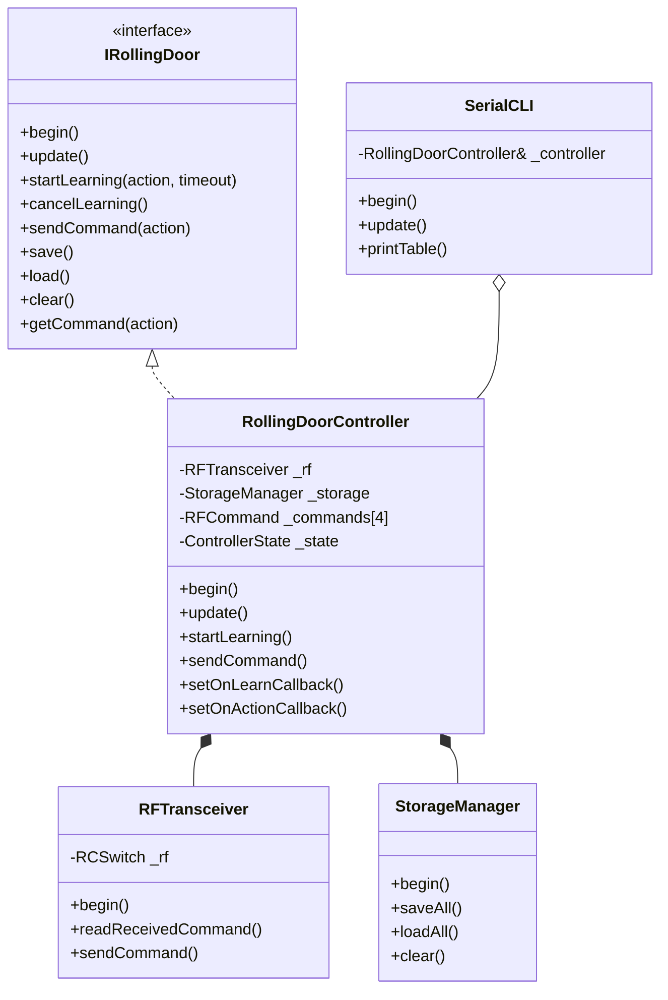

# Hướng Dẫn Sử Dụng: Điều Khiển Cửa Cuốn RF 433MHz (Phiên Bản V1 - Serial CLI)

Dự án điều khiển cửa cuốn từ xa sử dụng vi điều khiển **ESP32-S3** (sẵn sàng chuyển đổi sang **ESP8266**), học lệnh 4 nút chức năng: **Lên (Up)**, **Xuống (Down)**, **Dừng (Stop)**, **Khóa (Lock)** từ remote RF 433MHz gốc, lưu trữ vĩnh viễn vào bộ nhớ Flash và kiểm tra phát lệnh qua cổng Serial Monitor.

---

## 1. Tính Năng Nổi Bật

* **Học lệnh RF 433MHz chính xác:** Ghi nhận đầy đủ 4 thông số: `Mã code`, `Độ dài bit` (bitLength), `Giao thức` (protocol), và `Độ rộng xung` (pulseLength). Đảm bảo phát lại chuẩn xác 100% cho mọi loại cửa cuốn mã cố định (Fixed code) hoặc mã học (Learning code EV1527, PT2262, v.v.).
* **Giao diện dòng lệnh Serial CLI chuyên nghiệp:**
  * Học lệnh từng nút với đếm ngược timeout (15s), chống dội tín hiệu (debounce).
  * Hiển thị bảng mã chi tiết dạng ASCII Table trực quan.
  * Thử phát lệnh trực tiếp (`test up`, `test down`, `test stop`, `test lock`).
  * Lưu trữ vĩnh viễn vào Flash (`save`), nạp lại (`load`), hoặc xóa trắng (`clear`).
  * Chế độ **RF Sniffer / Scan** quét sóng xung quanh để kiểm tra phần cứng và remote.
* **Kiến trúc Hướng Đối Tượng (OOP) chuẩn mực:**
  * Tách biệt hoàn toàn tầng điều khiển logic (`RollingDoorController`) khỏi tầng truyền thông/giao diện (`SerialCLI`).
  * Sẵn sàng tích hợp thêm WebServer AP, Blynk IoT Cloud, hoặc Google Apps Script mà **không cần sửa đổi logic cửa**.
* **Đa nền tảng (Cross-platform):** Tự động nhận diện cấu hình cho cả **ESP32-S3** (Preferences/NVS) và **ESP8266** (EEPROM Flash Sector).

---

## 2. Sơ Đồ Đấu Nối Phần Cứng (Wiring Diagram)

### 2.1. Danh Sách Linh Kiện
1. Vi điều khiển: **ESP32-S3** (hoặc ESP8266 NodeMCU / WeMos D1 Mini).
2. Module thu RF 433MHz: RXB6, SYN480R, hoặc MX-05V (khuyến nghị **RXB6** hoặc **SYN480R** độ nhạy cao).
3. Module phát RF 433MHz: FS1000A, SYN115, hoặc STX882.
4. Ăng-ten: Dây đồng đơn lõi dài **17.3 cm** (tương ứng 1/4 bước sóng 433.92MHz) hàn vào chân `ANT` của cả module thu và phát để tăng cự ly thu phát.

---

### 2.2. Sơ Đồ Chân ESP32-S3

| Tên Module | Chân Module | Chân Trên ESP32-S3 | Ghi Chú |
|:---|:---|:---|:---|
| **Bộ Thu RF 433** | VCC | 5V | Cấp 5V để cự ly bắt sóng tốt nhất |
| | GND | GND | Nối chung mass |
| | DATA | **GPIO 8 (Qua FET)** | FET hạ áp 5V -> 3.3V, bảo vệ chân ESP32-S3 |
| **Bộ Phát RF 433** | VCC | 5V (hoặc 9-12V) | Cấp 5V phát sóng xa và khỏe |
| | GND | GND | Nối chung mass |
| | DATA | **GPIO 9 (Qua FET)** | FET kích áp xung từ 3.3V lên 5V công suất cao |
| **LED Trạng Thái** | Chân Dương (+) | **GPIO 2** (qua trở 1k) | Nhấp nháy khi học lệnh, sáng khi phát |

> [!TIP]
> Người dùng có thể thay đổi các chân kết nối tùy theo thiết kế bo mạch thực tế trong file `Config.h`.

---

### 2.3. Sơ Đồ Chân Chuyển Sang ESP8266 (NodeMCU / WeMos D1)

| Tên Module | Chân Module | Chân ESP8266 (GPIO) | Ký Hiệu Board |
|:---|:---|:---|:---|
| **Bộ Thu RF 433** | DATA | **GPIO 4** | **D2** |
| **Bộ Phát RF 433** | DATA | **GPIO 5** | **D1** |
| **LED Trạng Thái** | LED Built-in | **GPIO 2** | **D4** (LED tích hợp trên board) |

---

## 3. Cài Đặt Thư Viện

Trước khi biên dịch bằng Arduino IDE, hãy cài đặt thư viện giải mã 433MHz tiêu chuẩn:

1. Mở **Arduino IDE**.
2. Vào **Sketch** -> **Include Library** -> **Manage Libraries...** (hoặc nhấn `Ctrl + Shift + I`).
3. Trong ô tìm kiếm, gõ: `rc-switch` (tác giả: **sui77**).
4. Nhấn **Install** để cài đặt.

---

## 4. Hướng Dẫn Sử Dụng Serial CLI

Sau khi nạp chương trình vào bo mạch:
1. Mở **Serial Monitor** trong Arduino IDE.
2. Cài đặt tốc độ Baud: **`115200`**.
3. Cài đặt chế độ kết thúc dòng: **`Both NL & CR`** hoặc **`Newline`**.

### Bảng Lệnh CLI

| Lệnh | Ý Nghĩa & Ví Dụ |
|:---|:---|
| `help` hoặc `?` | Hiển thị bảng trợ giúp và hướng dẫn sử dụng. |
| `show` hoặc `list` | Hiển thị bảng danh sách mã RF 4 trạng thái (Lên, Xuống, Dừng, Khóa). |
| `learn <nut>` | Chuyển sang chế độ học lệnh cho nút (`up`, `down`, `stop`, `lock` hoặc `1..4`).<br>Ví dụ: `learn up` hoặc `learn 1` |
| `cancel` | Hủy chế độ học lệnh nếu đang đợi remote mà không muốn tiếp tục. |
| `test <nut>` | Thử phát sóng RF cho nút tương ứng để kiểm tra cửa cuốn.<br>Ví dụ: `test up` hoặc `test 1` |
| `save` | Ghi vĩnh viễn các lệnh vừa học vào bộ nhớ Flash (NVS / EEPROM). |
| `load` | Tải lại các lệnh đã lưu từ Flash ra RAM. |
| `clear` | Xóa sạch bộ nhớ Flash và đặt các nút về trạng thái chưa học. |
| `sniff on` | Bật chế độ quét sóng liên tục (hữu ích để dò remote lạ hoặc test bộ thu). |
| `sniff off` | Tắt chế độ quét sóng liên tục. |

---

### Quy Trình Học Lệnh Mẫu

```text
1. Gõ: learn up
   >>> [CHẾ ĐỘ HỌC LỆNH] Đang chờ tín hiệu cho nút: UP - Lên (Mở cửa)
   >>> Hướng remote vào anten thu 433MHz và BẤM GIỮ NÚT trong 1-2 giây...

2. Bấm giữ nút LÊN trên remote:
   >>> [HỌC THÀNH CÔNG] Nút: UP (Lên (Mở cửa))
       - Mã Hex     : 0x00A1B2C3
       - Mã Dec     : 10597059
       - Số Bit     : 24
       - Protocol   : 1
       - Pulse delay: 350 us

3. Lặp lại với các nút còn lại:
   learn down  -> Bấm nút XUỐNG trên remote
   learn stop  -> Bấm nút DỪNG trên remote
   learn lock  -> Bấm nút KHÓA trên remote

4. Kiểm tra danh sách:
   show

5. Thử điều khiển cửa:
   test up     -> Cửa cuốn bắt đầu mở lên!

6. Lưu vào bộ nhớ Flash:
   save
   >>> [THÀNH CÔNG] Đã lưu 4 lệnh vào Flash! Không bị mất khi khởi động lại.
```

---

## 5. Kiến Trúc Hướng Đối Tượng (OOP Design)

Dự án được thiết kế theo mô hình tách lớp độc lập:



* **`RollingDoorController`**: Hoàn toàn không phụ thuộc vào `Serial`. Nó quản lý State Machine, thời gian chờ, chống dội, kiểm tra tính hợp lệ và gọi các Callbacks khi có sự kiện.
* **`SerialCLI`**: Chỉ là một tầng giao diện (Adapter). Khi có ký tự từ cổng nối tiếp, nó gọi phương thức tương ứng của `RollingDoorController`.

---

## 6. Lộ Trình Nâng Cấp (Roadmap)

Nhờ kiến trúc OOP này, các tính năng tiếp theo có thể được thêm vào cực kỳ đơn giản:

1. **Nâng cấp WebServer Access Point (AP Mode):**
   * Tạo module `WebServerManager.h/.cpp`.
   * Tạo trang web giao diện responsive trên điện thoại (4 nút: Lên, Xuống, Dừng, Khóa và nút Học Lệnh).
   * Khi người dùng bấm nút trên Web, WebServer chỉ cần gọi:
     ```cpp
     doorController.sendCommand(ACTION_UP);
     ```
2. **Nâng cấp Blynk IoT Cloud:**
   * Thêm `BlynkSimpleEsp32.h`.
   * Gán nút bấm ảo Blynk Virtual Pin:
     ```cpp
     BLYNK_WRITE(V1) {
         if (param.asInt()) doorController.sendCommand(ACTION_UP);
     }
     ```
3. **Nâng cấp Google Apps Script:**
   * Gửi HTTP Webhook tới Google Sheet / AppScript để ghi log thời gian đóng/mở cửa hoặc nhận lệnh điều khiển từ xa.
4. **Chuyển đổi sang ESP8266 (Cost Optimization):**
   * Chỉ cần đổi cấu hình Board trong Arduino IDE sang **NodeMCU 1.0 (ESP-12E)** hoặc **WeMos D1 R2 & mini**.
   * Toàn bộ mã nguồn tự động biên dịch sang nền tảng EEPROM của ESP8266 mà không cần sửa 1 dòng code nào.
