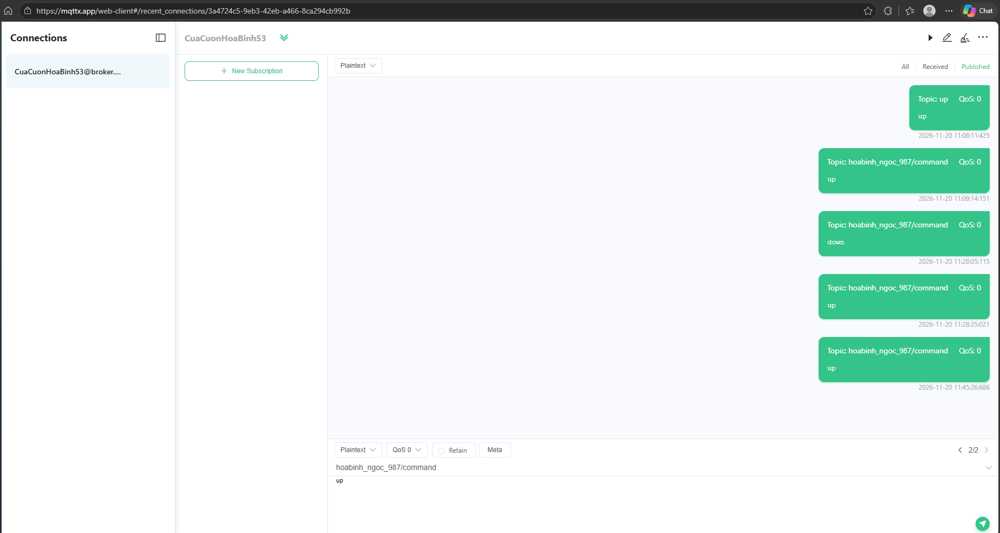

## Y261120

---

### Test MQTT app adroid

### Test MQTT WEB

https://mqttx.app/web

https://mqttx.app/web-client#/recent_connections/3a4724c5-9eb3-42eb-a466-8ca294cb992b

### Test Web AP

### Test google Script

### Test RF 433

==========================================================================

+-----+--------+-------------------+------------+------------+------+-------+-----------+
| STT | NÚT    | CHỨC NĂNG         | MÃ HEX     | MÃ DEC     | BITS | PROTO | XUNG (us) |
+-----+--------+-------------------+------------+------------+------+-------+-----------+
|  1  | UP     | Len (Mo cua)      | 0x00199214 | 1675796    |  24  |   1   |   207     |
|  2  | DOWN   | Xuong (Dong cua)  | 0x00199218 | 1675800    |  24  |   1   |   206     |
|  3  | STOP   | Dung (Tam dung)   | 0x00199212 | 1675794    |  24  |   1   |   206     |
|  4  | LOCK   | Khoa (Khoa cua)   | 0x00199211 | 1675793    |  24  |   1   |   206     |
+-----+--------+-------------------+------------+------------+------+-------+-----------+
Trạng thái bộ nhớ Flash: [ĐÃ ĐỒNG BỘ VỚI FLASH]